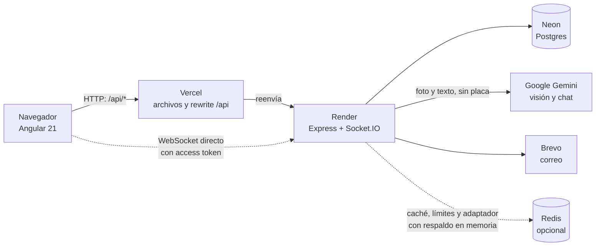

# AutoCheck-CO Backend

[](https://github.com/Pipemora1324/autocheck-backend/actions/workflows/ci.yml)

API REST en Express 5 + TypeScript para AutoCheck-CO: un garaje personal con **diagnóstico de testigos del tablero con IA**. El usuario registra sus vehículos, fotografía un testigo encendido (o lo describe o lo elige de una lista) y la app le explica qué es, qué tan urgente es, qué puede revisar con seguridad y cuándo ir al mecánico, con el motivo concreto. Usa Postgres (Neon) y autenticación propia con JWT.

## Qué es real, qué es IA y qué queda como trabajo futuro

| Parte | Estado |
| --- | --- |
| Cuentas, login, sesiones con refresh rotativo, verificación de correo, recuperación de contraseña, borrado de cuenta, admin por `ADMIN_EMAILS` | **Real**: funciona contra Postgres |
| Garaje (`/garage`): vehículos que registra cada usuario | **Real**, con **solo los datos que el usuario registra**. No es una consulta oficial |
| Diagnóstico con foto o descripción | **IA (Gemini).** Lee todos los testigos encendidos, hasta 8, y **redacta la explicación**. El servidor aplica su piso de seguridad encima. Con `SCAN_PROVIDER=none`, otro proveedor o sin clave, responde 503 |
| Chat sobre un diagnóstico | **IA (Gemini).** La conversación se guarda en Postgres, sin imágenes. El servidor bloquea cualquier respuesta que sugiera seguir manejando con un testigo que ordena detenerse |
| Piso de seguridad (`src/domain/diagnosisSafety.ts`) | **Real**: lo aplica el servidor, sin importar lo que diga el modelo. **Pendiente:** debe revisarlo una persona con conocimiento mecánico |
| Catálogo de testigos (`src/data/telltales.ts`, `GET /telltales`) | **Real**: 41 testigos versionados en el código. Ya **no** es la fuente de las respuestas con IA: solo se usa en la elección manual, disponible con `SCAN_PROVIDER=none`, sin clave o cuando el proveedor falla. **Pendiente:** revisión mecánica |
| Diagnóstico con elección manual (`telltaleId`) | **Real**, sin IA y sin enviar nada a terceros. Funciona aunque la IA esté apagada |
| Historial de diagnósticos | **Real**, en Postgres, sin la imagen. Guarda los testigos con su explicación, para releerla sin llamar a la IA |
| Lectura de la tarjeta de propiedad (`POST /garage/scan-card`) | Opcional para registrar el vehículo. **Real**, con un **proveedor externo** intercambiable (`SCAN_PROVIDER`): Gemini (plan gratuito, recomendado) o Anthropic. Apagada con `none` o sin la clave del proveedor |
| Tiempo real (Socket.IO) | **Real**, opcional para el usuario: progreso del diagnóstico, respuesta del chat ya validada y sincronización entre pestañas. Si no conecta, todo sigue por HTTP |
| Caché y límites con Redis (`REDIS_URL`) | **Real y opcional**, con un **proveedor externo**. Sin Redis funcionan en memoria |
| Correo (verificación y recuperación) | **Proveedor externo**: Brevo por HTTPS en producción (Render gratuito bloquea SMTP). En desarrollo los enlaces salen por consola |

**El diagnóstico es orientación general:** no reemplaza a un mecánico y no lee los códigos de falla del vehículo. Cada respuesta lo dice.

**Precisión medida:** el 2026-11-05, con `gemini-3.5-flash-lite` y 7 capturas de tableros, las 7 dieron testigos y ninguna dio error. En fotos claras el resultado es estable y coincide con lo que se ve. En fotos pequeñas o borrosas **varía entre corridas** y puede incluir testigos que no están: es una muestra pequeña, sin validación de un mecánico. El modelo también puede clasificar como freno de mano un testigo de frenos: el servidor lo corrige si el nombre deja dudas, no si el modelo afirma sin más que es el freno de mano.

**Cupo de Gemini:** el plan gratuito limita las solicitudes por día y por modelo, y ese cupo se comparte entre todos los usuarios, la lectura de tarjetas y el chat. `gemini-3.5-flash` agotó su cupo diario el 2026-11-05 tras unas decenas de llamadas y tuvo muchos 503. Por eso el modelo recomendado para Render es **`GEMINI_MODEL=gemini-3.5-flash-lite`**.

**Trabajo futuro:**

- Consultar el RUNT con un proveedor autorizado. Se retiró porque la información es confidencial y de pago; ni el código ni los datos asociados siguen en este repositorio.
- Medir la precisión del reconocimiento con un conjunto amplio de fotos reales, revisado por un mecánico.

## Arquitectura



- **HTTP es la vía principal.** El diagnóstico y el chat funcionan completos aunque el socket nunca conecte.
- **El socket va directo a Render**, porque Vercel no reenvía WebSockets. Se autentica con el access token, no con cookies.
- **El piso de seguridad está en el servidor:** lo que llega por HTTP o por el socket ya pasó por él.
- **Capas:** `routes` → `controllers` → `services` → `repositories`, con las dependencias inyectadas por constructor para poder probarlas. La configuración se valida en un solo módulo (`src/config/env.ts`).

### Redis opcional

Sin `REDIS_URL`, o si Redis falla, todo sigue funcionando en memoria y `GET /health` responde 200: solo su campo `redis` cambia.

| Uso | Clave | Vida |
| --- | --- | --- |
| Catálogo de testigos | `v1:catalog:telltales` | 5 min |
| Garaje de un usuario | `v1:user:<id>:garage` | 60 s, y se invalida al escribir |
| Historial de un vehículo | `v1:user:<id>:vehicle:<id>:history:<página>:<límite>` | 60 s, y se invalida al escribir |
| Límites de intentos | `v1:rl:<nombre>:<sha256>` | La ventana del límite |
| Adaptador de Socket.IO | Canales de Pub/Sub | No guarda datos |

Las claves solo llevan ids o hashes: nunca correos, placas ni textos. En Redis no entran imágenes ni el contenido del chat. Borrar la cuenta borra todas las claves del usuario. Si Redis se cae y vuelve, una lista puede quedar vieja hasta que venza su TTL, que por eso es corto.

## Calidad

```bash
npm run lint           # ESLint estricto con información de tipos
npm run lint:fix
npm run format:check   # Prettier
npm run typecheck
npm run test:coverage  # pruebas con cobertura (coverage/)
```

El CI corre todo esto en cada push y en cada PR hacia `main`, con Postgres y Redis reales en contenedores, Gemini siempre simulado y **ningún secreto**.

**Idioma por capa:** el código (variables, funciones, clases) va en inglés. Los campos del contrato con el frontend (`urgenciaGeneral`, `testigos`) y todo lo que lee una persona (mensajes, comentarios, commits, documentación) van en español.

## Requisitos

- Node.js 24+
- Una base Postgres: [Neon](https://neon.tech), o un Postgres local para desarrollo

## Puesta en marcha

```bash
cp .env.example .env   # completa DATABASE_URL, JWT_SECRET y JWT_REFRESH_SECRET
npm install
npm run migrate        # crea las tablas
npm run dev
```

Las variables se validan al arrancar con zod; si falta o es inválida alguna, el proceso termina indicando cuál. Ver `.env.example`.

## Scripts

| Comando                | Descripción                                           |
| ---------------------- | ----------------------------------------------------- |
| `npm run dev`          | Servidor en modo watch (`tsx`, lee `.env`)            |
| `npm run build`        | Compila TypeScript a `dist/`                          |
| `npm start`            | Ejecuta la build compilada                            |
| `npm run typecheck`    | Verifica tipos de `src/` y de las pruebas             |
| `npm run migrate`      | Aplica las migraciones pendientes (lee `.env`)        |
| `npm run migrate:down` | Revierte la última migración                          |
| `npm run migrate:prod` | Migraciones desde `dist/` (lo usa Render al arrancar) |
| `npm test`             | Pruebas con el test runner de Node                    |
| `npm run test:coverage` | Pruebas con cobertura                                |
| `npm run lint` / `lint:fix` | ESLint estricto                                  |
| `npm run format` / `format:check` | Prettier                                   |
| `npm run eval:telltales` | Lee tus fotos con Gemini real y muestra los testigos |
| `npm run smoke:gemini` | Lista los modelos de tu clave y prueba cuáles responden |

Las pruebas usan repositorios en memoria, y Gemini simulado: no necesitan base de datos ni llaman a APIs externas. Para correr también las de integración contra Postgres, define `TEST_DATABASE_URL` con una base desechable cuyo nombre contenga `test`; su esquema se borra en cada corrida. Con `TEST_REDIS_URL` corren además las de Redis real; sin ella, solo las de Redis caído, que usan un puerto cerrado.

## Evaluar el reconocimiento con fotos reales

`npm run eval:telltales` envía tus fotos a **Gemini de verdad**. Las respuestas pasan por el mismo piso de seguridad del servidor, así que muestra lo que vería el usuario. No compara con un resultado esperado: revisa la lista contra tus fotos.

1. Define `GEMINI_API_KEY` en tu `.env` local. Funciona aunque `SCAN_PROVIDER` sea `none`.
2. Copia tus imágenes en la carpeta `eval-images/`, en la raíz. Git la ignora.
3. Ejecuta el comando.

Muestra, por archivo, el resultado y la urgencia general y, por testigo, nombre, urgencia, categoría, color y confianza. Los errores solo muestran su tipo.

Espera 7 segundos entre llamadas para respetar el plan gratuito (`EVAL_DELAY_MS` lo cambia) y, si Gemini responde 429, espera un minuto y reintenta una vez. **Gasta el cupo diario de Gemini, y las fotos van a Google:** usa solo imágenes que puedas compartir. Nunca imprime la clave.

Si los diagnósticos fallan, `npm run smoke:gemini` muestra qué modelos responden con tu clave y qué cupo se agotó. También acepta modelos concretos: `npm run smoke:gemini -- gemini-3.5-flash-lite`.

## Endpoints

El contrato completo, con ejemplos de cuerpo y respuesta, está en [docs/API.md](docs/API.md). En resumen:

- **Públicos:** `GET /health`, `GET /config/public` (consentimiento, avisos y proveedores activos), `POST /auth/register` (exige `acceptedTerms: true`), `/auth/login`, `/auth/refresh`, `/auth/logout`, `/auth/forgot-password`, `/auth/reset-password`, `/auth/verify-email`, `/auth/resend-verification`.
- **Con token:** `GET /auth/me`, `DELETE /auth/me`, `GET /telltales`.
- **Con token y correo verificado** (si no: `403 EMAIL_NOT_VERIFIED`):
  - `GET/POST /garage`
  - `GET/PATCH/DELETE /garage/:plate`
  - `GET /garage/capabilities`
  - `POST /garage/scan-card`
  - `POST /garage/:plate/diagnoses`
  - `GET /garage/:plate/diagnoses`
  - `GET /garage/:plate/diagnoses/:id`
  - `DELETE /garage/:plate/diagnoses/:id`

## Tratamiento de datos personales (Ley 1581 de 2012)

> Texto base para un proyecto académico, no es asesoría legal.
>
> **Nota para confirmar (Juan Felipe Mora):** revisa que el nombre y el correo del responsable sean los correctos antes de abrir el servicio al público. Si cambias este texto o el de `REGISTRATION_CONSENT_TEXT`, sube `PRIVACY_POLICY_VERSION` en `src/services/privacyPolicy.ts`.

**Responsable del tratamiento:** Juan Felipe Mora · Correo de contacto para consultas, reclamos y solicitudes: `juan.morarevel@campusucc.edu.co`.

**Autorización.**

- El registro exige marcar `acceptedTerms: true`, con el texto de `GET /config/public` (`privacyPolicy.registrationConsent`).
- Se guardan la fecha de aceptación (`users.terms_accepted_at`) y la versión de esta política (`users.terms_version`, hoy `2026-11-04.1`) como prueba de la autorización previa, expresa e informada.

**Qué se guarda y para qué**

| Dato | Dónde | Finalidad |
| --- | --- | --- |
| Correo electrónico | `users` | Identificar la cuenta, iniciar sesión, enviar enlaces de verificación y recuperación |
| Contraseña | `users.password_hash` | Solo el hash argon2id; la contraseña nunca se guarda ni se registra |
| Rol, fechas de registro, verificación y aceptación | `users` | Control de acceso y evidencia del consentimiento |
| Sesiones | `refresh_tokens` | Identificador y vigencia de cada sesión (no el token) para poder revocarlas |
| Tokens de verificación y recuperación | `email_verification_tokens`, `password_reset_tokens` | Solo el hash sha256; expiran en 24 h y 30 min y son de un solo uso |
| Vehículos del garaje | `user_vehicles` | Datos que el usuario registra (placa, marca, línea, año, color, combustible, kilometraje, etc.). **No** se guarda el documento del propietario |
| Historial de diagnósticos | `diagnoses` | Testigos con su explicación, severidad, confianza, descripción que escribió el usuario y fecha, para que consulte sus diagnósticos anteriores. **No** se guarda la imagen. El usuario puede borrar cada uno |
| Conversación con la IA | `diagnosis_messages` | Mensajes del usuario y respuestas sobre cada diagnóstico. Solo texto. Se borra con el diagnóstico, el vehículo o la cuenta |
| Registros técnicos | Logs de Render | IP, método, ruta (con la placa enmascarada y sin cadena de consulta), código de respuesta y hora, para seguridad y diagnóstico. No se registran cuerpos de petición, tokens, imágenes, descripciones, placas ni datos extraídos de documentos |

**Encargados externos**

- **Brevo:** envía los correos de verificación y recuperación (correo del usuario y enlace).
- **Neon:** aloja la base de datos.
- **Render:** aloja la API.
- **Proveedor de lectura de la tarjeta:** recibe la foto, solo si el usuario usa esa función.
- **Proveedor de diagnóstico (Google, Gemini API):** recibe la foto del tablero, la descripción y la marca, línea, año y combustible del vehículo, solo si el usuario pide el diagnóstico con IA. Si usa el chat, recibe además sus mensajes, la conversación, el diagnóstico y el kilometraje. No recibe la placa.

**Foto de la tarjeta de propiedad**

- **Para qué se envía:** la foto se envía a un **proveedor externo** de inteligencia artificial solo para extraer los datos. El proveedor activo se informa en `GET /config/public` (`cardScan.provider` y `cardScan.notice`) y el frontend lo muestra antes de subirla.
  - Con `SCAN_PROVIDER=gemini`: Google, Gemini API, plan gratuito.
  - Con `SCAN_PROVIDER=anthropic`: Anthropic.
  - Ambos están en EE. UU., lo que implica una transmisión internacional de datos.
- **Plan gratuito de Gemini:** Google puede usar el contenido enviado, incluida la foto, para mejorar sus productos.
- **Qué hace AutoCheck-CO con ella:** la recibe en memoria y la descarta al terminar la petición. No la escribe en disco ni en la base de datos, y no la registra en logs.
- **Datos extraídos:** se devuelven únicamente al usuario para que los confirme. No se guardan ni se escriben en logs. El documento y el nombre del propietario no se extraen.
- **Tarjetas ajenas:** **no se debe subir la tarjeta de otra persona sin su autorización.** El usuario lo declara al aceptar la política.

**Foto del tablero (diagnóstico con IA)**

- **Para qué se envía:** la foto del tablero se envía a un **proveedor externo** de inteligencia artificial para identificar los testigos y explicarlos. El frontend muestra `diagnosis.notice` de `GET /config/public` antes de subirla.
- **Plan gratuito de Gemini:** el proveedor (Google, en EE. UU.) puede usarla para mejorar sus productos.
- **Qué hace AutoCheck-CO con ella:** la procesa en memoria y **no la guarda en sus servidores**: ni en disco, ni en la base de datos, ni en logs.
- **Alternativa:** elegir el testigo de la lista no envía nada a terceros.

**Derechos del titular**

- **Conocer y actualizar:** `GET /auth/me`, la edición de los vehículos del garaje y el historial de diagnósticos.
- **Suprimir:** `DELETE /auth/me` borra la cuenta, sus sesiones, sus tokens, sus vehículos, sus diagnósticos y sus conversaciones. Borrar un vehículo borra su historial, y cada diagnóstico también se puede borrar por separado.
- **Revocar la autorización:** se hace eliminando la cuenta.
- **Otras solicitudes:** al correo del responsable indicado arriba.

## Estructura

```
migrations/          SQL versionado (node-pg-migrate)
docs/API.md          Contrato HTTP para el frontend
src/config/          Validación de variables de entorno (zod)
src/db/              Pool de conexiones y runner de migraciones
src/routes/          Definición de rutas
src/data/            Catálogo de testigos (fuente de verdad del diagnóstico)
src/domain/          Placas colombianas y firma de imágenes
src/controllers/     Validación de entrada y respuesta HTTP
src/services/        Reglas de negocio (auth, garaje, diagnóstico, identificación con IA, lectura de tarjeta, correo)
src/repositories/    Acceso a datos (Postgres)
src/middleware/      Auth, rate limit, registro de peticiones sin datos sensibles y manejo de errores
scripts/             Revisión de secretos antes de subir y evaluación del reconocimiento
```

## Despliegue

Ver [DEPLOY.md](DEPLOY.md): Neon, Render, Vercel, Brevo, Gemini y la lista de pasos manuales pendientes.

## Frontend

El cliente Angular vive en [autocheck-frontend](https://github.com/Pipemora1324/autocheck-frontend).
